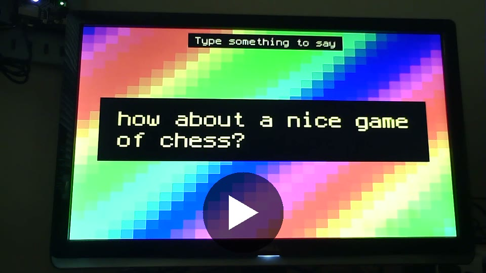

# Feather RP2350 DVI Audio Text to Speech Demo (CircuitPython)

Type a line in the serial console. It shows up on the DVI monitor over a scrolling rainbow and is spoken out loud through the DVI cable to the monitor's speakers.

[](https://drive.google.com/file/d/1xfBMuaHyRcCAYDVG0KMvX4MGRpopmXwz/view?usp=sharing)

**Click the image to play the 23 second demo video (with sound) on Google Drive.**

## What you need

- **Feather RP2350 with 8 MB PSRAM.** PicoTTS needs the PSRAM: its voice data alone is about 1.5 MB.
- **DVI HSTX adapter** plugged into the Feather's HSTX connector, with a monitor that has speakers (or an audio out).
- **CircuitPython from PR #11574**, which adds `board.DVI_AUDIO`. It isn't merged yet, so use the firmware `.uf2` from the [release](https://github.com/mikeysklar/feather-dvi-audio-circuitpython-tts-demo/releases/latest).
- **`settings.toml`** with two lines: force DVI on, and use 320 wide to save RAM.
- **A speech library:** PicoTTS (used by the demo) or Moonshine Klatt.
- **A serial terminal** to type into the REPL console.

## Quick start (one file)

`feather-rp2350-dvi-tts-demo-full.uf2` (in the [release](https://github.com/mikeysklar/feather-dvi-audio-circuitpython-tts-demo/releases/latest)) holds the firmware plus a full CIRCUITPY drive: `code.py`, `settings.toml`, both example scripts, and the PicoTTS, Klatt, display_text and ticks libraries. Hold BOOT, tap RESET, and drag it onto the `RP2350` drive. **It replaces everything on CIRCUITPY.** Then skip to step 5.

Built with `folder2uf2 --combine <firmware.uf2> --family-id 0xe48bff59 --flash-offset 0x100000 --flash-size 0x800000`.

## Steps (by hand)

### 1. Flash the firmware

Hold BOOT, tap RESET, and copy `adafruit-circuitpython-adafruit_feather_rp2350-en_US-20261014-main-PR11574-efa6511.uf2` from the [release](https://github.com/mikeysklar/feather-dvi-audio-circuitpython-tts-demo/releases/latest) to the `RP2350` drive.

PR: https://github.com/adafruit/circuitpython/pull/11574

### 2. settings.toml

Copy `settings.toml` to `CIRCUITPY/`:

```toml
CIRCUITPY_PICODVI_ENABLE = "always"
CIRCUITPY_DISPLAY_WIDTH = 320
```

- `"always"` starts DVI even when the board can't read the monitor's EDID. Without it, `board.DVI_AUDIO` is `None`.
- At 640x480 there was only about 30 KB of heap left, and Klatt ran out of memory. 320 wide leaves plenty.

### 3. Install the libraries

Copy into `CIRCUITPY/lib/`:

- `adafruit_picotts/` (the whole folder, including the `.bin` voice files and the `.mpy`) from https://github.com/adafruit/Adafruit_CircuitPython_PicoTTS
- `adafruit_display_text/` and `adafruit_ticks.mpy` from the CircuitPython library bundle (or `circup install adafruit_display_text`, which pulls in `adafruit_ticks`)

Optional, the other engine we tried:

- `adafruit_moonshine_klatt/` from https://github.com/adafruit/Adafruit_CircuitPython_Moonshine_Klatt

### 4. Copy code.py

Copy `code.py` to `CIRCUITPY/`. If the board already has a display demo in `code.py`, replace it. On our board, the old one left `board.DVI_AUDIO` as `None`.

### 5. Connect and type

Open the serial console at 115200 baud, for example:

```
screen /dev/tty.usbmodem* 115200
```

You'll see `Type something to say:`. Press Enter if nothing shows up. Type a line and press Enter; it appears on the screen and is spoken. Backspace works. To leave `screen`, press `Ctrl-A`, then `K`, then `y`. The demo keeps running after you disconnect.

## How the audio works

- DVI audio only plays 48 kHz. PicoTTS renders at 16 kHz and Klatt at 22050 Hz.
- Each script plays the speech into its own low-rate `audiomixer.Mixer`, then feeds that through `audiospeed.Resampler` into a 48 kHz mixer playing on `board.DVI_AUDIO`.
- `tts.volume = 0.5`. The default 1.0 sounded over-amplified.
- The rainbow pauses while speech plays, because a full-screen redraw mid-sentence can starve the audio.

## Files

| File | What it is |
|---|---|
| `code.py` | The typing demo (PicoTTS + rainbow screen) |
| `picotts_dvi.py` | Speaks three phrases on a loop with PicoTTS, no screen. Rename to `code.py` to run it |
| `klatt_dvi.py` | Cycles through the Klatt voices on a loop. Rename to `code.py` to run it |
| `settings.toml` | The two DVI settings |
| `images/demo-thumbnail.jpg` | Thumbnail for the demo video link |

The two UF2 files are on the [release page](https://github.com/mikeysklar/feather-dvi-audio-circuitpython-tts-demo/releases/latest), not in the repo:

| File | What it is |
|---|---|
| `feather-rp2350-dvi-tts-demo-full.uf2` | Drop-in image: firmware + CIRCUITPY with code and libraries |
| `adafruit-circuitpython-adafruit_feather_rp2350-en_US-20261014-main-PR11574-efa6511.uf2` | CircuitPython build from PR #11574 for the Feather RP2350 (firmware only) |

## License

MIT-0. See `LICENSE`. The libraries and firmware keep their own licenses.
